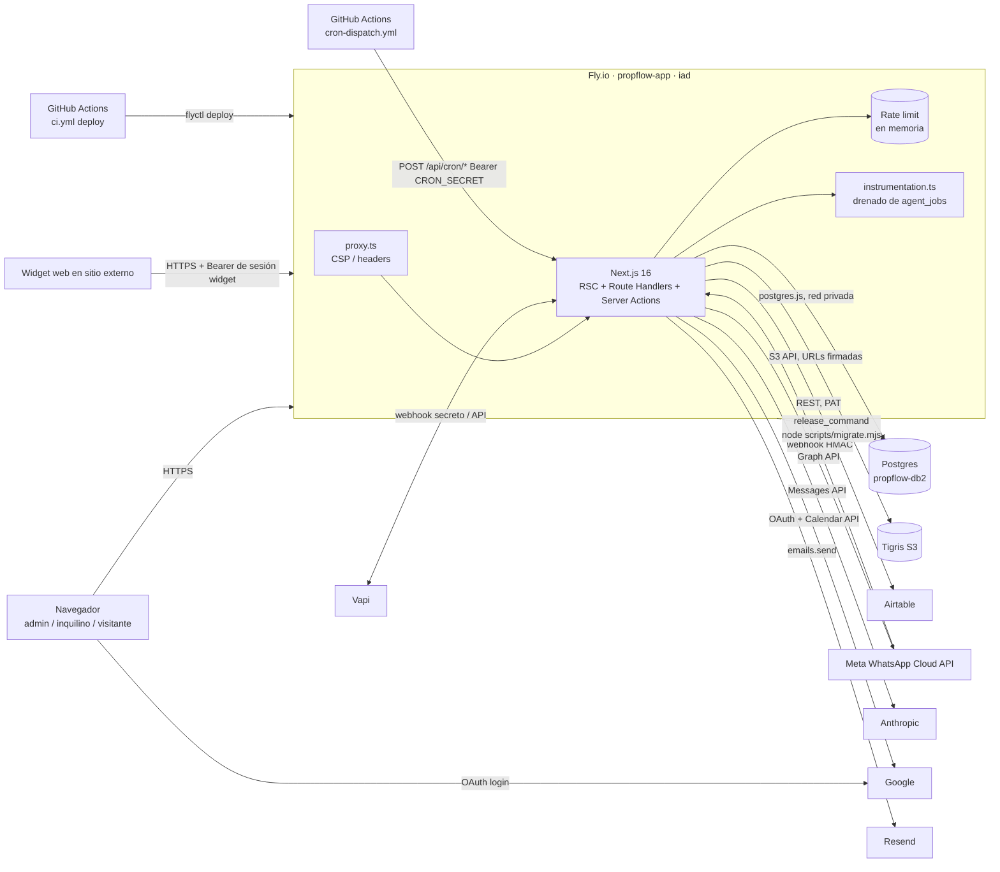

# 02 — Documento de Requisitos Técnicos (TRD)

Propflow es un SaaS multi-organización para gestión de propiedades en alquiler (inquilinos, unidades, contratos, pagos, incidencias, sincronización con Airtable) con un agente de IA para leasing por WhatsApp, widget web y voz. Este documento describe el estado técnico real del código desplegado en Fly.io (`propflow-app`). Las afirmaciones que no se verificaron línea a línea en el código están marcadas como **Supuesto**.

---

## 1. Stack y justificación

| Capa | Tecnología | Motivo |
|---|---|---|
| Framework | Next.js 16 (App Router) + React 19 + TypeScript | Un solo despliegue para UI, Route Handlers y Server Actions; renderizado en servidor que evita exponer lógica y secretos al cliente. |
| Middleware | `src/proxy.ts` (convención de Next 16) | Aplica CSP con nonce, cabeceras de seguridad y orígenes permitidos (Tigris, endpoint de reporte CSP). |
| ORM / BD | Drizzle ORM sobre `postgres.js`, Postgres en Fly (`propflow-db2`) | Tipado de esquema en TypeScript, SQL explícito, sin capa de abstracción pesada. Postgres en la misma red privada de Fly reduce latencia. |
| Pool de conexiones | `src/lib/db/index.ts`: `max 5`, `idle_timeout 20`, `max_lifetime 1800`, `connect_timeout 10` | Las máquinas Fly se suspenden; sockets ociosos caducados provocaban `CONNECTION_CLOSED`. Se añade `withDbRetry` en rutas sensibles. |
| Autenticación | NextAuth v5 con `DrizzleAdapter` y sesiones en base de datos | Sesiones revocables en servidor (tabla `sessions`), proveedor Google, y sesiones de email/contraseña creadas manualmente con el mismo formato. |
| Hash de contraseñas | `bcryptjs`, coste 12 | Implementación JS pura (sin binarios nativos en la imagen Docker). |
| Almacenamiento | Tigris (S3 compatible) vía `@aws-sdk/client-s3` | Integrado con Fly, API S3 estándar, URLs firmadas de corta duración. |
| IA | Anthropic SDK (`@anthropic-ai/sdk`) | OCR de comprobantes, chat del dashboard, resumen ejecutivo, verificación de pruebas de tareas y agente conversacional. |
| Mensajería | Meta WhatsApp Cloud API (`WHATSAPP_PROVIDER=meta`, con proveedor mock) | Canal principal de comunicación con inquilinos y leads en Perú. |
| Voz | Vapi | Llamadas salientes de reactivación y webhook de eventos de llamada. |
| Calendario | Google Calendar (OAuth propio, tokens cifrados AES-256-GCM) | Agenda de visitas sincronizada con el calendario del asesor. |
| Email | Resend | Envío transaccional (firmas, recordatorios). Requiere dominio verificado para entrega real. |
| Datos heredados | Airtable REST API | Fuente operativa existente del cliente; sincronización diaria a Postgres. |
| Validación | Zod | Validación de toda entrada de servidor. |
| Gestor de paquetes | pnpm 9, Node 22 | Instalaciones deterministas; no existe `package-lock.json`. |
| Hosting | Fly.io (región `iad`, `shared-cpu-1x`, 512 MB) | Coste bajo con `auto_stop_machines = "suspend"`, `release_command` para migraciones. |
| Cron | GitHub Actions (`cron-dispatch.yml`) | Las máquinas programadas de Fly no permiten hora exacta del día. |

---

## 2. Arquitectura

Flujo de trabajo asíncrono: los eventos del agente se encolan en `agent_jobs`. `instrumentation.ts` los drena dentro del proceso. El cron `agent-dispatch` (cada 10 minutos) actúa como respaldo cuando la máquina estaba suspendida.

---

## 3. Herramientas y CI

Comandos locales: `pnpm dev`, `pnpm lint`, `pnpm typecheck`, `pnpm test` (Vitest), `pnpm test:e2e` (Playwright), `pnpm build`. Los tests SQL usan PGlite porque Docker no está disponible en la máquina de desarrollo.

Jobs de `.github/workflows/ci.yml`:

| Job | Contenido | ¿Bloquea? |
|---|---|---|
| `quality` | typecheck | Sí |
| | lint | No (`continue-on-error`) |
| | tests unitarios (Vitest) | Sí |
| | test i18n | No (`continue-on-error`) |
| | build | Sí |
| | `pnpm audit` nivel high | No |
| | license-checker | No (`|| true`) |
| | chequeo de typosquatting | No |
| | size-limit | Sí |
| `sbom` | SBOM CycloneDX publicado como artefacto | Sí |
| `codeql` | Análisis CodeQL; SARIF como artefacto (`upload: false`) | No (`continue-on-error`) |
| `lighthouse` | Solo en pull requests | Sí (en PR) |
| `e2e` | Playwright contra staging, solo si `vars.E2E_ENABLED == 'true'` | Sí cuando se activa |
| `deploy` | `flyctl deploy --remote-only` en push a `main` | — |

Observación: lint, auditoría de dependencias y CodeQL no bloquean el merge. Un fallo de esos pasos solo queda visible en el log.

---

## 4. API interna (Route Handlers en `src/app/api`)

Total: **55 archivos `route.ts`, 61 handlers de método** (incluye `GET`/`POST` de NextAuth).

Leyenda de autenticación:
- **Sesión**: `requireUser` / `requireAdmin` / `requireTenant` (`src/lib/auth/guards.ts`) o `auth()` de NextAuth. Sin sesión, la respuesta es 401 (o redirección).
- **Org**: toda consulta filtra por `profiles.org_id` de la sesión.
- **RL**: rate limit en memoria por instancia (`src/lib/ratelimit.ts`).

Errores comunes en todas las rutas con sesión: 401 sin sesión, 403 por rol incorrecto, 400 por validación Zod, 500 genérico sin stack. Las columnas "Request" y "Response" resumen la forma. La forma exacta de cada DTO está en el handler.

| Método | Ruta | Auth | Rol | Request | Response | Errores específicos | Rate limit | ¿Paginada? |
|---|---|---|---|---|---|---|---|---|
| GET, POST | `/api/auth/[...nextauth]` | NextAuth | — | Flujo OAuth Google | Redirecciones / cookies | `AccessDenied`, `OAuthAccountNotLinked` | No | No |
| GET | `/api/health` | Ninguna | Público | — | `{ ok }` | — | No | No |
| GET | `/api/invite/peek` | Ninguna (token) | Público | `?token` | `{ maskedEmail, orgName }` | 400, 404, 410 expirada | No | No |
| POST | `/api/invite/accept` | `auth()` | Usuario sin org | `{ token }` | `{ ok }` + perfil tenant | 404, 410, 409 `ALREADY_IN_ORG` | No | No |
| GET | `/api/whatsapp/webhook` | Verify token (`hub.verify_token`) | Meta | `hub.*` | `hub.challenge` | 403 | No | No |
| POST | `/api/whatsapp/webhook` | HMAC `x-hub-signature-256` con `META_APP_SECRET` | Meta | Payload Meta | 200 | 401 firma inválida, 429 | 60/min/IP | No |
| GET | `/api/unit-image` | `requireUser` | admin; tenant solo su unidad | `?path` | 302 a URL firmada | 403, 404 | No | No |
| GET | `/api/task-proof` | `requireAdmin` | admin | `?path` | 302 a URL firmada | 404 | No | No |
| GET | `/api/incident-photo` | `auth()` | admin o tenant dueño | `?path` | 302 a URL firmada | 403, 404 | No | No |
| GET | `/api/tenant-avatar` | `requireUser` | admin / tenant | `?tenantId` | 302 a URL firmada | 404 | No | No |
| GET | `/api/portal/notifications/unread-count` | `requireTenant` | tenant | — | `{ count }` | 429 | Sí (`checkRateLimit`) | No |
| GET | `/api/calendar/google/connect` | `requireAdmin` | admin | — | 302 a Google + cookie de `state` | — | No | No |
| GET | `/api/calendar/google/callback` | `requireAdmin` + `state` (timingSafeEqual) + profileId | admin | `?code&state` | 302 a ajustes | 400 state inválido | No | No |
| GET | `/api/airtable-attachment` | `requireUser`, luego exige admin | admin | `?url` | Proxy del adjunto | 404 si no admin | Sí (`actionRateLimit`) | No |
| GET | `/api/contracts/[id]/pdf` | `requireUser` | admin; tenant solo el suyo | `id` | PDF | 403, 404 | No | No |
| POST | `/api/ai/executive-brief` | `requireAdmin` | admin | `{ period }` | `{ narrativeMarkdown, kpis }` | 429 | 10/min/usuario | No |
| POST | `/api/ai/chat` | `requireUser` | admin / tenant | `{ messages }` | Stream SSE | 429 límite o presupuesto de tokens | 5/min, 20/día/usuario, 500/día/org + `ai_token_budget` | No |
| GET | `/api/sign/[token]` | Ninguna (token UUID) | Firmante | `token` | Datos del contrato a firmar | 404 anti-enumeración, 410 | No | No |
| POST | `/api/sign/[token]` | Ninguna (token UUID) | Firmante | Firma PNG (data URL) | `{ ok }` | 404, 409 `ALREADY_SIGNED`, 429 | 5/min por token+IP | No |
| POST | `/api/cron/airtable-sync` | Bearer `CRON_SECRET` (timingSafeEqual) | Cron | — | Resumen de sync | 401 | No | No |
| POST | `/api/cron/weekly-summary` | Bearer `CRON_SECRET` | Cron | — | Resumen | 401 | No | No |
| POST | `/api/cron/reminders` | Bearer `CRON_SECRET` | Cron | — | Resumen | 401 | No | No |
| POST | `/api/cron/task-reminders` | Bearer `CRON_SECRET` | Cron | — | Resumen | 401 | No | No |
| POST | `/api/cron/qa-export` | Bearer `CRON_SECRET` | Cron | — | Resumen | 401 | No | No |
| POST | `/api/cron/lead-alerts` | Bearer `CRON_SECRET` | Cron | — | Resumen | 401 | No | No |
| POST | `/api/cron/agent-dispatch` | Bearer `CRON_SECRET` | Cron | — | Jobs procesados | 401 | No | No |
| POST | `/api/cron/voice-reactivation` | Bearer `CRON_SECRET` | Cron | — | Llamadas lanzadas | 401 | No | No |
| POST | `/api/tenant/register` | `auth()` | Usuario autenticado | Datos de inquilino | `{ ok }` | 400, 409 | No | No |
| GET | `/api/public/listing-image/[imageId]` | Ninguna | Público | `?src=unit|listing` | 302 a URL firmada (1 h) | 404 si el listing no está publicado | 120/min/IP | No |
| GET | `/api/tenant/payments` | `requireTenant` | tenant | Filtros | Lista de pagos propios | — | No | **Supuesto**: sí |
| GET | `/api/tenant/payments/summary` | `requireTenant` | tenant | — | Agregados | — | No | No |
| GET | `/api/tenant/payments/movements` | `requireTenant` | tenant | `?page&pageSize` | Movimientos | — | No | **Supuesto**: sí |
| POST | `/api/tenant/payments/import` | `requireTenant` | tenant | CSV | Resultado de importación | 400 | No | No |
| POST | `/api/tenant/payments/import/check` | `requireTenant` | tenant | CSV | Validación previa | 400 | No | No |
| GET | `/api/tenant/payments/import/template` | `requireTenant` | tenant | — | CSV plantilla | — | No | No |
| GET | `/api/admin/tenants` | `requireAdmin` | admin | `?q&page` | Lista de inquilinos | — | No | **Supuesto**: sí |
| POST | `/api/admin/tenants` | `requireAdmin` | admin | Datos de inquilino | Inquilino creado | 400, 409 | No | No |
| GET | `/api/admin/tenants/[tenantId]` | `requireAdmin` | admin | — | Inquilino | 404 | No | No |
| PATCH | `/api/admin/tenants/[tenantId]` | `requireAdmin` | admin | Campos parciales | Inquilino actualizado | 400, 404 | No | No |
| POST | `/api/admin/tenants/[tenantId]/invite` | `requireAdmin` | admin | — | Invitación creada | 404, 409 | No | No |
| POST | `/api/admin/tenants/import` | `requireAdmin` | admin | CSV | Resultado | 400 | No | No |
| POST | `/api/admin/tenants/import/check` | `requireAdmin` | admin | CSV | Validación previa | 400 | No | No |
| GET | `/api/admin/tenants/import/template` | `requireAdmin` | admin | — | CSV plantilla | — | No | No |
| GET | `/api/admin/imports` | `requireAdmin` | admin | — | Historial de importaciones | — | No | **Supuesto**: límite fijo |
| GET | `/api/admin/imports/[importId]` | `requireAdmin` | admin | — | Detalle y filas | 404 | No | No |
| PATCH | `/api/admin/payments/[paymentId]/approve` | `requireAdmin` | admin | — | Pago aprobado | 404, 409 | No | No |
| PATCH | `/api/admin/payments/[paymentId]/reject` | `requireAdmin` | admin | `{ reason }` | Pago rechazado | 404, 409 | No | No |
| POST | `/api/admin/payments/import` | `requireAdmin` | admin | CSV | Resultado | 400 | No | No |
| POST | `/api/admin/payments/import/check` | `requireAdmin` | admin | CSV | Validación previa | 400 | No | No |
| GET | `/api/admin/payments/import/template` | `requireAdmin` | admin | — | CSV plantilla | — | No | No |
| POST | `/api/admin/integrations/airtable/sync` | `requireAdmin` | admin | — | Resumen de sync | 502 | No | No |
| GET | `/api/admin/integrations/airtable/status` | `requireAdmin` | admin | — | Estado de conexión | — | No | No |
| GET | `/api/receipts/[id]/url` | `requireUser` | admin; tenant solo sus subidas | `id` | `{ url }` firmada | 404 | No | No |
| POST | `/api/receipts/ocr` | `requireUser` | admin / tenant | `{ receiptId }` | Datos extraídos | 429, 422 | 15/día/usuario, 500/día/org | No |
| POST | `/api/agent/web/session` | Mismo origen (`isSameAppOrigin`) + `publicKey` | Visitante | `{ publicKey }` | 201 `{ token, expiresAt, greeting, orgName, whatsappAvailable }` | 403, 404, 429, 503 `DAILY_CAP` | 5/10 min/IP | No |
| GET | `/api/agent/web/messages` | Bearer de sesión widget | Visitante | — | Historial de la sesión | 401 | Sí | No |
| POST | `/api/agent/web/messages` | Bearer de sesión widget | Visitante | `{ text }` | Respuesta del agente | 401, 429 | 20/min/IP, 6/min y 120/día por sesión | No |
| GET | `/api/agent/qa-export` | `requireAdmin` | admin | — | Exportación QA | 429 | 30/min/usuario | No |
| POST | `/api/agent/voice/vapi` | `X-Vapi-Secret` o Bearer `VAPI_WEBHOOK_SECRET` (timingSafeEqual) | Vapi | Evento Vapi | 200 | 401 | No | No |
| GET | `/api/agent/voice/recording/[callId]` | `requireAdmin` | admin | — | Grabación / redirección | 404 | No | No |

### Rutas sin sesión de usuario

Todas son intencionales y tienen otro mecanismo de control:
- `/api/health`: público, sin datos.
- `/api/invite/peek`: protegido por token de invitación (sha256 en BD). Devuelve email enmascarado. No tiene rate limit; el token tiene suficiente entropía.
- `/api/sign/[token]`: protegido por un UUID aleatorio. El GET no tiene rate limit.
- `/api/public/listing-image/*`: público por diseño. Solo sirve listings publicados de organizaciones elegibles.
- `/api/agent/web/session` y `/api/agent/web/messages`: protegidos por origen, clave pública y token de sesión widget.
- `/api/whatsapp/webhook`, `/api/agent/voice/vapi` y `/api/cron/*`: protegidos por firma HMAC o secreto compartido.

---

## 5. Server Actions (`src/app/actions`)

Total: **131 funciones exportadas en 34 archivos**. Patrón general: primero el guard de rol, luego el rate limit `mutationRateLimit` (30/min/usuario), luego validación Zod. Toda consulta filtra por el `orgId` del contexto. La verificación individual de cada acción es **Supuesto** salvo donde se indica.

| Archivo (n.º acciones) | Auth / rol | Scoping por org |
|---|---|---|
| `auth.ts` (5): `signIn`, `signInWithPassword`, `registerWithEmail`, `requestPasswordReset`, `signOut` | Públicas. Rate limit 5/10 s por IP | No aplica. El registro crea una org nueva |
| `onboarding.ts` (1): `createOrg` | Sesión sin perfil. 5/10 s | Crea la org y el perfil admin |
| `profile.ts` (1) | `requireUser` | Perfil propio |
| `tenants.ts` (11) | `requireAdmin`. Acciones de avatar propio con `requireTenant`/`requireUser` | `org_id` de la sesión |
| `unit-images.ts` (7) | `requireAdmin`. `getUnitImagesTenant` usa `requireTenant` | `org_id`. El tenant solo ve su unidad |
| `properties.ts` (4), `contracts.ts` (2), `contractDoc.ts` (4) | `requireAdmin` | `org_id` |
| `payments.ts` (3), `finance.ts` (5), `pricing.ts` (2) | `requireAdmin`. La subida de comprobante usa `requireUser` (**Supuesto**) | `org_id` |
| `incidents.ts` (3), `community.ts` (4) | `requireUser` | `org_id`. El tenant actúa sobre sus propios registros |
| `sanctions.ts` (4) | `requireAdmin`. `disputeSanction` usa `requireTenant` | `org_id` + tenant dueño |
| `tasks.ts` (4), `ops.ts` (8), `visitors.ts` (2) | `requireAdmin` | `org_id` |
| `imports.ts` (3), `mappings.ts` (6), `airtable.ts` (2) | `requireAdmin` | `org_id` |
| `analyst.ts` (1), `executive-brief.ts` (1) | `requireAdmin` | `org_id` |
| `calendar.ts` (4), `visit-availability.ts` (4), `visits.ts` (5) | `requireAdmin` | `org_id` + `profile_id` del asesor |
| `whatsapp.ts` (2), `agent-inbox.ts` (6) | `requireAdmin` | `org_id` |
| `agent-setup.ts` (1), `agent-settings.ts` (8), `agent-playground.ts` (1), `agent-widget.ts` (3), `agent-templates.ts` (2) | `requireAdmin` | `org_id` |
| `leads-pipeline.ts` (8), `lead-routing.ts` (4) | `requireAdmin` | `org_id` |

---

## 6. APIs externas

| Servicio | Uso | Límites | Timeout | Reintentos | Comportamiento ante fallo |
|---|---|---|---|---|---|
| Airtable REST | Sync diario (`src/lib/airtable/client.ts`) y escrituras (`write.ts`) | 5 req/s por base; throttle propio de 200 ms; `MAX_PAGES` 100 | **Sin timeout** (`client.ts:198`, `write.ts:73,109,132`, `api/tenant/register/route.ts:147`). Solo `airtable/status/route.ts:61` usa 5 s | 429: backoff exponencial 1 s × 2^n, máximo 3. 422: reintenta sin el campo de foto. 404 en update: crea el registro | La sync registra `airtable_sync_logs` con estado `partial` o `error`. El cron devuelve un código distinto de 200 y el job de GitHub falla |
| Anthropic | OCR, chat, resumen ejecutivo, verificación de pruebas, clasificación de WhatsApp, agente | Rate limits propios (sección 4) + `ai_token_budget` por org | OCR: AbortController (`OCR_TIMEOUT_MS`). `run-ocr.ts`, `whatsapp/classify.ts` y `task-proof.ts`: AbortController. **Sin timeout explícito**: `api/ai/chat/route.ts:97` (stream), `api/ai/executive-brief/route.ts:239`, `lib/agent/run-turn.ts:195` (cliente singleton `lib/ai/client.ts:15` sin `timeout`) | Reintentos por defecto del SDK (2) | Chat: error en el stream. Brief: sin API key usa una narrativa determinista. Agente: el job queda pendiente y se reintenta desde `agent_jobs` (**Supuesto**) |
| Meta WhatsApp Graph | Envío de mensajes, plantillas, descarga de adjuntos, verificación de setup | Límites por tier de número | `meta-provider.ts` 15 s (`:95`, `:404`, `:428`). `meta-templates-api.ts:69,146`. Adjuntos 20 s (`attachments.ts:32`, `whatsapp-receipt.ts:50`). Verificación en `agent-setup.ts:60` | No hay reintento HTTP. Los jobs del agente se reintentan vía cola | Error registrado. El mensaje queda en estado fallido |
| Google OAuth / Calendar | Login (NextAuth) y agenda de visitas | Cuota de la API de Calendar | Token 10 s (`calendar/google/oauth.ts:92`). Revocación 5 s (`:163`). Cliente Calendar con AbortController | No | Si falla, la visita se crea sin evento de calendario (**Supuesto**) |
| Vapi | Llamadas salientes | Plan de Vapi | `vapi-client.ts:60` (`REQUEST_TIMEOUT_MS`) | No | Llamada marcada como fallida |
| Resend | Emails transaccionales | Plan de Resend. El remitente sandbox solo entrega al dueño de la cuenta | **Sin timeout explícito** (`lib/notifications/email.ts:46`, timeout por defecto del SDK) | No inmediato. El siguiente cron reintenta | `sendEmail` nunca lanza: devuelve `{ success: false }` y registra el error |
| Tigris S3 | Fotos, comprobantes, contratos, firmas | — | **Sin timeout configurado** en `S3Client` (`lib/storage/index.ts:117`); usa los valores por defecto del SDK | Reintentos estándar del SDK de AWS (3) | Error 500 genérico en la ruta |
| Fetch de URL firmada propia | OCR descarga la imagen | — | **Sin timeout** (`api/receipts/ocr/route.ts:70`) | No | 500 |
| Imagen OG | `src/app/p/[orgSlug]/[listingSlug]/opengraph-image.tsx:62` | — | **Sin timeout** | No | Imagen OG sin foto (**Supuesto**) |

---

## 7. Variables de entorno y secretos (solo nombres)

| Variable | Dónde vive |
|---|---|
| `DATABASE_URL` | Fly secret (runtime y `release_command`); `.env.local` |
| `AUTH_SECRET` | Fly secret; GitHub secret (e2e). También firma HMAC de sesiones widget, slot IDs y `state` OAuth de Calendar |
| `AUTH_GOOGLE_ID`, `AUTH_GOOGLE_SECRET`, `NEXTAUTH_URL` | Fly secret |
| `ADMIN_ALLOWLIST`, `PRIMARY_OWNER_EMAIL` | Fly secret |
| `CRON_SECRET` | Fly secret + GitHub secret (mismo valor) |
| `TOKEN_ENCRYPTION_KEY` | Fly secret (clave AES-256 de tokens de Calendar) |
| `ANTHROPIC_API_KEY`, `AGENT_MODEL`, `AGENT_VOICE_MODEL` | Fly secret |
| `RESEND_API_KEY`, `RESEND_FROM_EMAIL` | Fly secret (pendientes de configurar según el historial operativo) |
| `TIGRIS_ENDPOINT`, `TIGRIS_ACCESS_KEY_ID`, `TIGRIS_SECRET_ACCESS_KEY`, `TIGRIS_BUCKET_*` | Fly secret (los inyecta `fly storage create`) |
| `STORAGE_ENDPOINT`, `STORAGE_REGION`, `AWS_REGION`, `STORAGE_ACCESS_KEY_ID`, `STORAGE_SECRET_ACCESS_KEY`, `STORAGE_BUCKET` | Fly secret (alias heredados) |
| `WHATSAPP_PROVIDER`, `WHATSAPP_ACCESS_TOKEN`, `WHATSAPP_PHONE_NUMBER_ID`, `WHATSAPP_BUSINESS_ACCOUNT_ID`, `WHATSAPP_WEBHOOK_VERIFY_TOKEN`, `WHATSAPP_WEBHOOK_SECRET`, `META_APP_SECRET` | Fly secret |
| `VAPI_API_KEY`, `VAPI_WEBHOOK_SECRET`, `VAPI_WEBHOOK_URL` | Fly secret |
| `GOOGLE_CALENDAR_REDIRECT_URI` | Fly secret |
| `AIRTABLE_PAT`, `AIRTABLE_BASE_ID`, `AIRTABLE_TABLE_*` (15), `AIRTABLE_FIELD_ROOM_PHOTOS` | Fly secret |
| `SENTRY_DSN`, `CSP_REPORT_URI` | Fly secret (opcionales) |
| `NEXT_PUBLIC_SITE_URL`, `NEXT_PUBLIC_META_APP_ID` | Build args en `fly.toml`. Son públicos por diseño |
| `FLY_API_TOKEN` | GitHub secret (job `deploy`) |
| `STAGING_DATABASE_URL`, `STAGING_SITE_URL` | GitHub secret (job `e2e`) |
| `APP_URL`, `E2E_ENABLED` | GitHub repository variables |
| `NODE_ENV`, `NEXT_PHASE`, `NEXT_RUNTIME`, `MIGRATIONS_DIR` | Los fija el runtime o el build. `MIGRATIONS_DIR` solo se usa en tests |

---

## 8. Hosting (Fly.io)

- App `propflow-app`, región `iad`. Imagen construida desde el `Dockerfile` con build remoto.
- `release_command = "node scripts/migrate.mjs"`. Corre antes de arrancar las máquinas nuevas. Si falla, el deploy se aborta y la versión anterior sigue activa.
- `[http_service]`: `internal_port = 3000`, `force_https = true`, `auto_stop_machines = "suspend"`, `auto_start_machines = true`, `min_machines_running = 0`.
- VM `shared-cpu-1x`, 512 MB.

Consecuencias:
- La primera petición tras un periodo inactivo paga la reanudación.
- Las conexiones Postgres del pool pueden estar muertas al reanudar. Lo mitigan `idle_timeout`, `max_lifetime` y `withDbRetry`.
- El rate limit en memoria se pierde al reiniciar y no se comparte entre máquinas.
- Postgres `propflow-db2` es una app Fly Postgres separada, accesible por la red privada `.internal`.

---

## 9. Observabilidad

- **Logs**: `src/lib/log.ts` emite JSON estructurado (`log.info`, `log.warn`, `log.error`, más `authFailure`/`authSuccess`). Fly los recoge (`fly logs`). Las rutas evitan registrar PII; por ejemplo, el email solo registra el dominio del destinatario.
- **Errores**: Sentry es opcional, vía `SENTRY_DSN`. Si la variable falta, solo hay logs.
- **CSP**: las violaciones se reportan a `CSP_REPORT_URI` si está definida.
- **Salud**: `/api/health` sirve para el healthcheck.
- **Crons**: cada job de GitHub Actions falla si la respuesta no es 200. El historial de Actions funciona como monitor de crons.
- **Sync Airtable**: queda registrada en `airtable_sync_logs`.
- **Agente**: `agent_events` y `qa_exports` guardan métricas y exportaciones semanales.
- **Limitación**: no hay métricas APM, trazas distribuidas ni alertas automáticas configuradas en el repositorio (**Supuesto**: no existe alerta externa sobre fallos de cron).
