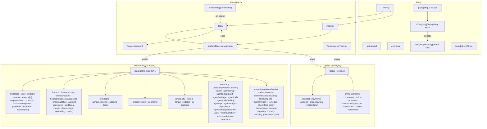

# 03 — Flujo de la aplicación (ingeniería inversa)

> Reconstruido desde `src/app` (87 páginas `page.tsx` + el route handler `/widget/[publicKey]`), `src/proxy.ts`, `src/lib/auth/*` y los layouts. Lo inferido está marcado como **Supuesto**. Roles y funciones: ver `01-PRD.md`.

## 1. Mapa de pantallas

Conteo: 12 pantallas públicas o de autenticación, 14 del portal del inquilino y 61 del panel de administración, más el iframe del widget.



## 2. Pantallas: propósito, rol, datos y estados

Convención para todas las pantallas del panel: Server Component que llama a `requireAdmin()` (o `requireTenant()` en el portal); si lanza error, `redirect('/login')`. Consultan Drizzle directamente filtrando por `ctx.orgId` y mutan con server actions de `src/app/actions/*`. Estados comunes: **cargando** (`loading.tsx` con skeletons en 29 rutas del panel), **vacío** (`EmptyState`), **con datos** y **error de acción** (objeto `ActionResult` con `error.code`/`message`). No hay `error.tsx`: un error no controlado cae en la página de error por defecto de Next.

### 2.1 Público y autenticación

| Pantalla | Propósito | Rol | Fuente de datos | Estados |
|---|---|---|---|---|
| `/` | Landing comercial: problemas, funciones, precios | Anónimo | `next-intl` (`landing`) | Estático |
| `/login` | Ingreso con email/contraseña o Google | Anónimo | action `signIn`; botón Google → NextAuth con `callbackUrl=/auth/callback` | Banner por `?error=` (`oauth_failed`, `account_not_created`, `email_conflict`, `invalid_callback`), error de formulario, enviando |
| `/register` | Alta de cuenta y organización | Anónimo | action `registerWithEmail` | Validación, `EMAIL_TAKEN`, `USE_GOOGLE`, `RATE_LIMITED` |
| `/forgot-password` | Pedido de recuperación | Anónimo | action `requestPasswordReset` (responde `NOT_IMPLEMENTED`) | Mensaje "usar Google" |
| `/auth/callback` | Despacha por rol tras login | Cualquiera | `auth()` + cookie `auth_redirect_to` | Solo redirige |
| `/invite/accept` | Aceptar invitación al portal | Anónimo o autenticado | `GET /api/invite/peek`, `GET /api/auth/session`, action `signInWithPassword`, `POST /api/invite/accept` | `loading`, `ready`, `signing_in`, `accepting`, `done`, `error` |
| `/onboarding` | Crear organización (`?type=admin`) o completar datos de inquilino (`?type=tenant`) | Autenticado sin perfil | action `createOrg`; `POST /api/tenant/register` | **Supuesto:** inalcanzable (ver §6) |
| `/sign/[token]` | Ver y firmar contrato con lienzo | Firmante con token | `GET`/`POST /api/sign/[token]` | Cargando, listo, firmado, token inválido |
| `/p/[orgSlug]` y `/p/[orgSlug]/[listingSlug]` | Catálogo público de unidades y ficha con imagen OG | Anónimo | Consultas públicas; imágenes por `/api/public/listing-image/[imageId]` | `not-found.tsx` si la organización no publica |
| `/widget/[publicKey]` | Chat del agente embebido en sitios de terceros (cargado por `/widget.js`) | Anónimo | `POST /api/agent/web/session`, `POST /api/agent/web/messages` (mismo origen) | CSP/CORS propios por organización |
| `/privacidad`, `/terminos` | Textos legales para Meta y Google | Anónimo | Estático | Estático |

### 2.2 Panel de administración (`/dashboard`)

| Pantalla | Propósito | Datos y acciones clave |
|---|---|---|
| `/dashboard` | KPIs generales, salud de datos, banner de diagnóstico | Consultas directas; `EmptyState` para organizaciones vacías |
| `properties`, `units`, `units/[id]` | Inventario; ficha de unidad con pestaña de imágenes | `createProperty`, `updateProperty`, `createUnit`, `updateUnit`, `uploadUnitImage`, `setUnitCoverImage`, `reorderUnitImages`, `deleteUnitImage`, `updateUnitImageCaption` |
| `tenants`, `tenants/[id]` | Lista y ficha 360° con pestañas | `createTenant`, `updateTenant`, `assignTenantToUnit`, `addInternalNote`, `linkTenantPortalAccount`, `searchAuthUserByEmail`; PDF por `GET /api/contracts/[id]/pdf`; CSV por `/api/admin/tenants/import/*` |
| `responsables` | Responsables sincronizados de Airtable | Lectura |
| `contracts`, `contracts/templates` | Contratos y plantillas | `createContract`, `updateContractStatus`, `createContractTemplate`, `updateContractTemplate`, `generateContractPdf`, `sendSignatureRequest` |
| `payments` | KPIs de cobranza, tabla (200 filas), cargos | `approvePayment`, `createCharge`; `POST /api/admin/payments/[paymentId]/approve` y `/reject`; CSV `/api/admin/payments/import/{template,check}` y `/import` |
| `incidents`, `incidents/[id]` | Bandeja y detalle de incidencias | `updateIncident`, `addIncidentComment`; fotos por `/api/incident-photo` |
| `finance` y subpáginas | Gastos, recibos OCR, rentabilidad por habitación, servicios | `createExpense`, `updateExpense`, `createExpenseCategory`, `uploadReceipt`, `matchReceiptToPayment`; `POST /api/receipts/ocr`; `GET /api/receipts/[id]/url` |
| `account-statements`, `additional-charges`, `tax-receipts`, `forecasting` | Estados de cuenta, cargos, comprobantes, proyección | Lectura agregada sobre todas las filas |
| `pricing` | Tablas de precios | `createPricingTable`, `updatePricingTable` |
| `reminders`, `announcements`, `cleaning` | Operación diaria | `scheduleReminder`, `createAnnouncement`, `publishAnnouncement`, `createCleaningTask`, `updateCleaningTask` |
| `leads` | Kanban de leads con etapas y ruteo | `moveLeadStage`, `assignLead`, `autoAssignLead`, `setDoNotContact`, `createStage`, `updateStage`, `reorderStages`, `deleteStage`, `createLead`, `updateLead`, `saveRoutingMode` |
| `executive-brief`, `ai-analyst`, `ai-assistant` | Inteligencia | `runHiddenLeakDetector`, `runDeterministicAnalysis`, `POST /api/ai/chat`, `/api/ai/executive-brief` |
| `community`, `visitors`, `tenant-feedback` | Comunidad y visitantes | `createCommunityPost`, `updateCommunityPost`, `pinPost`, `addCommunityComment`, `createVisitorLog`, `updateVisitorLog` |
| `whatsapp`, `whatsapp/[conversationId]` | Conversaciones de WhatsApp | `sendWhatsappMessage`, `markConversationRead` |
| `agent` | Métricas del agente | Lectura |
| `agent/setup` | Canal de WhatsApp y plantillas de Meta | `saveWhatsAppChannel`, `syncWhatsAppTemplates`, `getWhatsAppTemplateStatus`; muestra la URL de `/api/whatsapp/webhook` |
| `agent/settings` | Pestañas: identidad, conocimiento, horario, seguimientos, límites, voz, ruteo, canales | `saveAgentIdentity`, `saveAgentKnowledge`, `saveAgentBusinessHours`, `saveAgentFollowupPolicy`, `saveAgentLimits`, `saveAgentVoiceConfig`, `addDoNotCallNumber`, `removeDoNotCallNumber`, `upsertRoutingMemberAction`, `removeRoutingMemberAction`, `saveFollowupPolicy` |
| `agent/playground` | Probar el agente sin enviar mensajes reales | `runPlaygroundTurn` |
| `agent/inbox`, `agent/inbox/[sessionId]` | Bandeja IA/Humano (50 sesiones más recientes), sugerencias pendientes | `takeOverSession`, `returnSessionToAi`, `sendAgentInboxReply`, `approveAgentSuggestion`, `discardAgentSuggestion`, `updateAgentLiveSettingsAction` |
| `agent/calls`, `agent/calls/[callId]` | Historial de llamadas de voz y grabación | `GET /api/agent/voice/recording/[callId]` |
| `agent/qa` | Exportar conversaciones para QA | `GET /api/agent/qa-export` |
| `agent/widget` | Configurar widget y catálogo público | `updateWidgetSettings`, `rotateWidgetKey`, `setPublicPages` |
| `visits`, `visits/availability` | Agenda semanal y disponibilidad | `createVisitManual`, `rescheduleVisitStaff`, `cancelVisitStaff`, `confirmVisitStaff`, `markVisitOutcomeAction`, `saveAdvisorSettings`, `replaceWeeklyWindows`, `addAvailabilityException`, `deleteAvailabilityException`; Google Calendar por `/api/calendar/google/connect`, `disconnectCalendar`, `resyncCalendarNow`, `resolveCalendarDrift` |
| `tasks`, `tasks/new` | Tareas para inquilinos | `createTenantTask`, `updateTenantTask`, `cancelTenantTask`, `verifyTaskProofAdminOverride` |
| `sanctions` | Sanciones | `proposeSanction`, `approveSanction`, `rejectSanction` |
| `admin/integrations/airtable` | Estado y disparo de la sincronización | `GET /api/admin/integrations/airtable/status`, `POST /api/admin/integrations/airtable/sync` |
| `admin/tenants`, `admin/tenants/[tenantId]` | Gestión de cuentas de portal e invitaciones | `GET/POST /api/admin/tenants`, `/api/admin/tenants/[tenantId]`, `POST /api/admin/tenants/[tenantId]/invite` |
| `admin/imports`, `admin/import/*` | Historial de importaciones y asistente CSV con mapeos | `GET /api/admin/imports`, `uploadCsvDryRun`, `commitCsvImport`, `getImportLogs`, `savePhantomRoomMapping`, `savePropertyMapping`, `saveAccountMapping` |

### 2.3 Portal del inquilino (`/portal`)

Navegación: barra superior en escritorio con 8 ítems; barra inferior en móvil con los 4 primeros (Resumen, Contrato, Pagos, Incidencias) más la campana de notificaciones (`GET /api/portal/notifications/unread-count`).

| Pantalla | Propósito | Datos y acciones |
|---|---|---|
| `/portal` | Resumen: unidad (con imágenes), contrato, saldo | Consultas por `tenants.profile_id = userId`; `getUnitImagesTenant` |
| `contract` | Ver contrato | PDF por `GET /api/contracts/[id]/pdf` (verifica pertenencia) |
| `payments` | Resumen, movimientos, informar pago, importar CSV | `GET /api/tenant/payments/summary`, `/movements`, `/import/template`, `POST /import/check`, `POST /import`; action `recordPayment` |
| `incidents`, `incidents/new`, `incidents/[id]` | Reportar con foto (cámara permitida) y seguir | `createIncident`, `addIncidentComment` |
| `announcements`, `community` | Avisos y comunidad | `addCommunityComment` |
| `tasks` | Tareas asignadas y prueba | Subida por `/api/task-proof` |
| `sanctions`, `sanctions/[id]/dispute` | Ver y disputar sanciones | `disputeSanction` |
| `notifications` | Bandeja de notificaciones | `markNotificationRead` |
| `profile` | Datos personales, avatar, idioma | `updateOwnTenantAvatar`, `deleteOwnTenantAvatar`, `updateMyPreferredLanguage`; `/api/tenant-avatar` |
| `visitors/new` | Registrar un visitante (no aparece en la navegación) | `createVisitorLog` |

## 3. Flujos clave

### 3.1 Login, registro y Google

```mermaid
sequenceDiagram
  participant U as Usuario
  participant L as /login o /register
  participant SA as Server action
  participant NA as NextAuth /api/auth/*
  participant CB as /auth/callback
  U->>L: email + contraseña
  L->>SA: signIn / registerWithEmail (rate limit 5 por 10 s por IP)
  SA->>SA: bcrypt compare (hash señuelo si no existe) / crear user + provisionUser
  SA->>SA: createUserSession (cookie authjs.session-token)
  SA-->>CB: redirect /auth/callback
  U->>NA: "Continuar con Google" (cookie opcional auth_redirect_to, 600 s)
  NA->>NA: events.createUser → allowlist ? adjuntar a org principal : nueva org + attemptAutoLink
  NA-->>CB: callbackUrl
  CB->>CB: auth(); rol admin→/dashboard, tenant→/portal; sin sesión→/login?error=oauth_failed; sin rol→/login?error=account_not_created
```

### 3.2 Aceptación de invitación

1. El admin invita desde `admin/tenants/[tenantId]` (`POST /api/admin/tenants/[tenantId]/invite`); se guarda el hash SHA-256 del token.
2. `/invite/accept?token=…` consulta `GET /api/invite/peek` (email enmascarado y nombre de la organización) y `GET /api/auth/session`.
3. Si ya hay sesión, acepta de inmediato. Si no, el usuario elige Google (`callbackUrl` vuelve a la misma URL) o contraseña (`signInWithPassword`, sin redirección).
4. `POST /api/invite/accept` valida vigencia, email coincidente y organización; crea el perfil `tenant` si falta, vincula `tenants.profile_id = users.id`, marca `accepted` y responde `redirectTo: /portal`.

### 3.3 Onboarding

`/onboarding` exige sesión y ausencia de perfil. Como el callback `session` de NextAuth devuelve `null` cuando no hay perfil, un usuario sin perfil no tiene sesión válida y es enviado a `/login`; uno con perfil es enviado a su área. **Supuesto:** la provisión real ocurre en `registerWithEmail` y en `events.createUser`, y esta pantalla queda como remanente.

### 3.4 Pagos

- Inquilino: `/portal/payments` → `recordPayment` (estado `pending`) o importación CSV (`check` → `import`).
- Admin: `/dashboard/payments` → `approvePayment` o `POST /api/admin/payments/[id]/approve` / `reject`; cargos con `createCharge`; conciliación de recibos en `finance/receipts` (`matchReceiptToPayment`).
- Sincronización: la tabla "Movimientos" de Airtable alimenta `payments` en el cron diario.

### 3.5 Portal del inquilino

Ingreso → `/auth/callback` → `/portal`. Cada página llama a `requireTenant()` y resuelve el inquilino con `tenants.profile_id = userId` y `org_id`. Las incidencias con foto usan `capture="environment"`, habilitado por `Permissions-Policy: camera=(self)` solo bajo `/portal`.

### 3.6 Bandeja del agente

1. Meta envía el mensaje a `/api/whatsapp/webhook` (firma verificada); se encola un turno (`cron/agent-dispatch` procesa la cola).
2. El agente responde en modo `ai`; con `shadow_mode` genera sugerencias pendientes.
3. El admin, en `agent/inbox/[sessionId]`, puede aprobar o descartar sugerencias, tomar el control (`human`), responder manualmente (fuera de 24 h solo plantillas) o devolver a la IA (reinicia el tope de turnos y reencola si hay entrantes).
4. Las visitas agendadas aparecen en `visits` y se sincronizan con Google Calendar; `cron/lead-alerts` y `cron/voice-reactivation` hacen seguimientos.

## 4. Rutas protegidas y redirecciones

### 4.1 `src/proxy.ts` (equivalente a middleware en Next 16)

- Excluye `_next/static`, `_next/image`, `favicon.ico`, `api/health` e imágenes estáticas.
- `/widget.js` y `/widget/*`: pasan sin encabezados agregados (definen su propio CSP y `frame-ancestors` por organización).
- Públicas totales (con CSP y encabezados de seguridad): `/`, `/login`, `/register`, `/forgot-password`, `/sign/*`, `/auth/*`, `/onboarding`, `/p`, `/p/*`, `/privacidad`, `/terminos`.
- Sin cookie de sesión (`authjs.session-token` o `__Secure-authjs.session-token`): `/dashboard/*` y `/portal/*` redirigen a `/login?redirect=<ruta>`. El resto pasa.
- La cookie solo es una pista: la validación real ocurre en layouts y guardas.

### 4.2 Layouts y guardas

| Capa | Regla |
|---|---|
| `dashboard/layout.tsx` | Sin usuario → `/login`. Perfil inexistente o rol distinto de `admin` → `/login`. |
| `portal/layout.tsx` | Sin usuario → `/login`. Perfil inexistente o rol distinto de `tenant` → `/dashboard`. |
| Páginas | `requireAdmin()` / `requireTenant()`; error → `/login`. |
| Server actions | `requireAdmin()` / `requireUser()` / `requireTenant()`; devuelven `UNAUTHORIZED`/`FORBIDDEN`; validan pertenencia por `org_id`. |
| API `/api/admin/*`, `/api/tenant/*` | Guardas equivalentes en cada handler. |
| API `/api/cron/*` | `CRON_SECRET`. |
| API públicas por diseño | `/api/health`, `/api/invite/peek`, `/api/sign/[token]`, `/api/agent/web/*` (clave pública y mismo origen), `/api/public/listing-image/*`, `/api/whatsapp/webhook` (firma), `/api/agent/voice/vapi` (secreto). |

## 5. Navegación entre áreas

- Admin que abre `/portal` → el layout lo envía a `/dashboard`.
- Tenant que abre `/dashboard` → el layout lo envía a `/login` (no a `/portal`), y como el proxy no lo saca de `/login`, ve el formulario de ingreso estando autenticado.
- Cerrar sesión: action `signOut` → `/login`.
- Cambio de idioma: `LanguageDropdown` en la barra superior (cookie `propflow_locale`).

## 6. Observaciones relevantes

1. **Chequeo de rol del proxy sin efecto.** `proxy.ts` construye `user = { app_metadata: {} }`, así que `role` siempre es `undefined`: las redirecciones admin↔tenant y la salida de `/login` para usuarios autenticados nunca se ejecutan (remanente de Supabase). No abre acceso, porque layouts y guardas validan, pero el comentario promete una protección que no existe.
2. **Redirección intencional sin filtro de rol.** `/auth/callback` respeta la cookie `auth_redirect_to` si empieza con `/` y no con `//`. No filtra `/\` (que algunos navegadores normalizan a `//`). La cookie la escribe el propio cliente; el riesgo es bajo, pero conviene endurecer el filtro.
3. **Semántica inconsistente de `tenants.profile_id`.** Las lecturas usan `users.id`; `attemptAutoLink` escribe `profiles.id`. Además corre después de crear la organización propia del usuario, por lo que el `insert` del perfil `tenant` choca con el perfil admin y la fila del inquilino de otra organización queda apuntando a ese perfil admin. Efecto práctico: auto-vinculación inefectiva y un vínculo entre organizaciones en la fila de inquilino.
4. **`/onboarding` y `POST /api/tenant/register` sin uso efectivo** (ver §3.3).
5. **Navegación móvil del panel**: `dashboard/layout.tsx` renderiza `AdminSidebar` y `AdminTopbar` sin `open`, `onClose` ni `onMenuClick`, y no usa `AdminShellClient`. **Supuesto:** en móvil la barra lateral queda oculta y el botón hamburguesa no hace nada.
